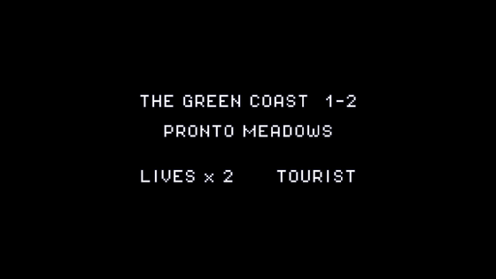
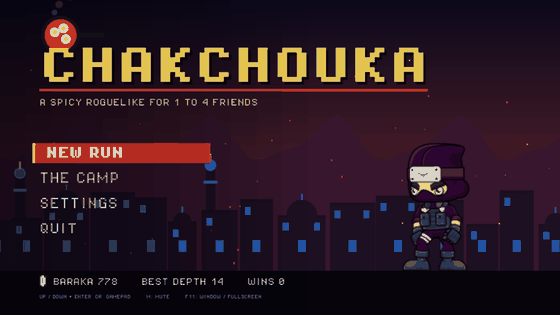
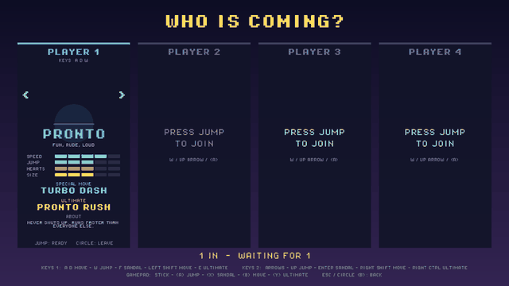
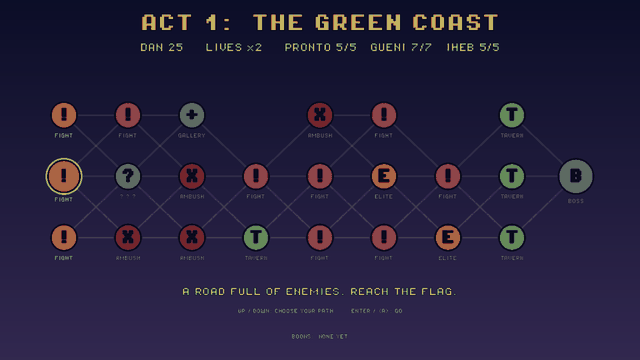
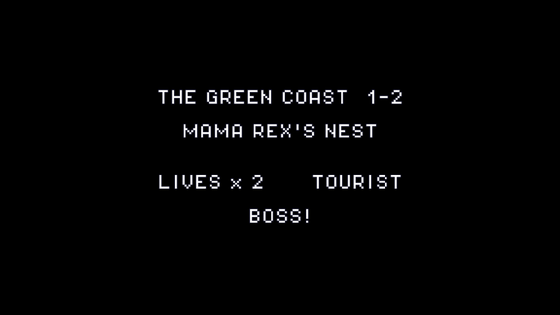
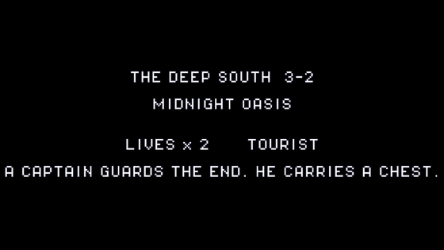
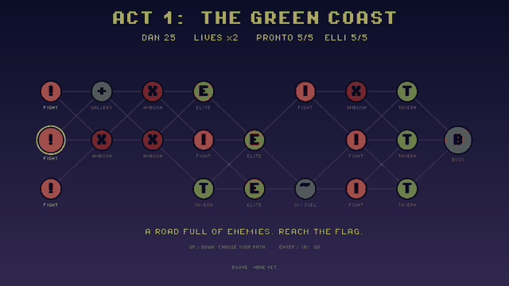
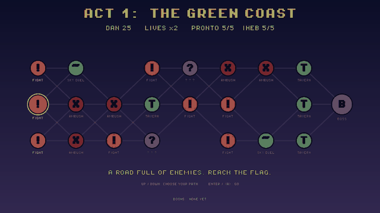
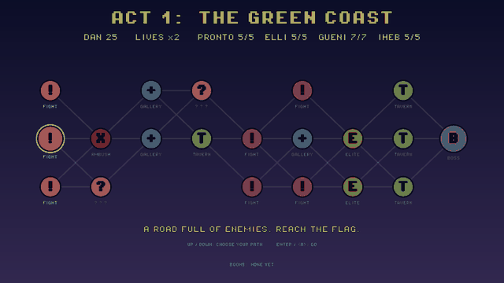
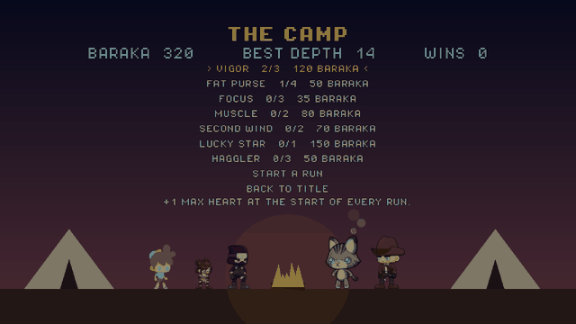

# CHAKCHOUKA

**A spicy couch-co-op roguelike platformer for 1 to 4 friends**, made with Godot 4.

<p align="center">
  
</p>

Pick your heroes, choose a path across a branching map, stomp and sandal-smack your way through
procedurally assembled stages, collect boons, beat the boss of each act, and spend what you earn at the
camp so the next run starts a little stronger.

## Features

- **1–4 players on one screen**: two keyboard halves plus up to four gamepads
- **5 heroes**, each with a passive, a special move and an ultimate
- **5 acts**, each a branching map of fights, ambushes, elites, minigames and taverns, ending in a boss
- **Stages built from text chunks** (`scripts/level_data.gd`, `scripts/run_gen.gd`) in themes like grass, medina, ocean, sahara, ice, cave, space and castle
- **Bosses** with telegraphed, three-phase attack plans: Mama Rex, Sidi Puffer, Baron Bat, King Pinky and The Ghoula
- **Boons** for the current run (Chechia, Couscous, Harissa, Brik, Iron Shleka…) and permanent **camp upgrades** bought with Baraka
- **Two minigames**: Sky Duel (a bullet-hell air fight) and a first-person shooting gallery
- **Three difficulties**: Tourist, Harissa and Mama's Shleka
- Chiptune music generated in code (`scripts/synth.gd`), full-screen with a window toggle, save between runs

## Screens

| Title | Hero select |
|---|---|
|  |  |
| **Run map and boons** | **Boss fight** |
|  |  |
| **Night stage** | **Sky Duel minigame** |
|  |  |
| **Shooting gallery minigame** | **The Tipsy Slime tavern** |
|  |  |
| **The camp (permanent upgrades)** | |
|  | |

## Heroes

| Hero | Passive | Special move | Ultimate |
|---|---|---|---|
| **PRONTO** | Runs faster than everyone else | **Turbo Dash**: invincible burst, on the ground or in the air | **Pronto Rush**: 3 s of unstoppable speed |
| **ELLI** | Small; getting hurt triggers 6 s of rage (faster, double damage); wall cling and wall jump | **Dive Kick**: diagonal air kick that bounces off enemies | **Tantrum**: rocket up, crash down, shockwave |
| **SHEE** | Hold jump in the air to glide | **VIP Entrance**: short teleport in any direction | **The Decree**: every enemy on screen freezes for 4 s and takes 1 damage |
| **GUENI** | Huge, 5 hearts; down in the air = ground pound | **Smoke Break**: a cloud that makes enemies dizzy | **Short Circuit**: full team heal, 4 s shield, zaps nearby enemies |
| **IHEB** | Throws bottles in an arc, faster than sandals | **Foam Jump**: rides the foam upwards, also mid-air | **Birra Storm**: a crate of bottles rains down, double damage |

## Controls

Join on the hero select screen by pressing **Jump** on your device. Alone on the keyboard, every key below works for you.

| | Move | Jump | Action (run / throw) | Special move | Ultimate |
|---|---|---|---|---|---|
| Keyboard left | A / D (S = down) | W / Space | F | Left Shift / G | E / Q |
| Keyboard right | Arrow keys | Up | Enter / Num 0 | Right Shift / Num 2 | Right Ctrl / Num 1 |
| Gamepad | Left stick / D-pad | A | X | B / LB | Y / RB |

Menus: arrows or WASD, Enter / Space to confirm, Esc / Backspace to go back. **P / Esc / Start** pauses, **M** mutes, **F11** toggles window / fullscreen.

## Running it

1. Install [Godot 4.7](https://godotengine.org/download) (the project uses the Compatibility renderer).
2. Clone the repo and open `project.godot` in Godot:
   ```bash
   git clone https://github.com/Gueni/pronto.git
   ```
3. Press **F5**. The game starts on `scenes/title.tscn`.

## Project layout

```
scenes/      one scene per screen (title, select, map, ascii_level, tavern, shmup, gallery, camp, end_screen)
scripts/     all game code; game.gd (autoload "Game") holds the run, heroes, boons and input schemes
assets/      sprites, characters, fonts, music and sounds
tools_tmp/   dev tools: automated run test, sprite packer, README GIF capture
docs/media/  the GIFs above
```

### Re-recording the GIFs

`tools_tmp/capture.gd` drives one scripted scene with simulated input, and Godot's movie writer saves the frames:

```bash
godot --path . --write-movie frames/level/f.png --fixed-fps 30 res://tools_tmp/capture.tscn -- shot=level len=10
py tools_tmp/make_gifs.py . docs/media 560 2 level:8:50
```

Shots: `title`, `select`, `map`, `level`, `level2`, `level3`, `boss`, `sky`, `gallery`, `tavern`, `camp`.
Recording plays through the map, so it overwrites the saved run in Godot's user data folder.
